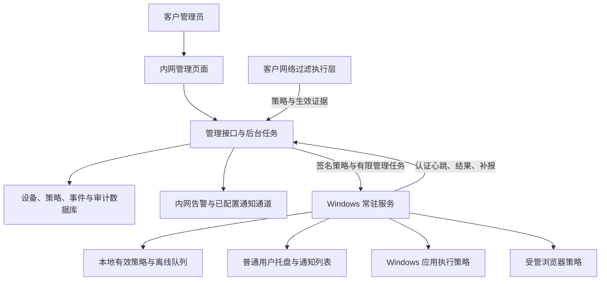

# 客户终端合规管控系统设计 v1

日期：2026-10-13，Asia/Shanghai。状态：设计完成，系统尚未实现或部署；已有 vpn-ai-check 0.2 为可运行的单次检查基础。

## 1. 已确认的目标与设计假设

用户已确认：客户禁止代理工具和国外 AI 软件，安装也不允许；需要安装后定时采集、违规通知、离线处理、阻止安装/执行和网站访问；允许管理员安装常驻服务并配置系统策略；管理端部署在客户内网服务器。

本设计选择 Windows 为第一平台，先支持 x64；其他架构经过安装、采集与执行层实机验证后再标支持。Windows 10/11 的具体构建号、补丁和客户现有安全策略以安装时能力探测为准，不因系统名字符合就宣称所有功能可用。

设计容量按单客户独立实例、最多500台终端作为首版压测目标，首批5台试点；这不是对实际客户数量的断言。默认 Linux 内网服务器部署，保留 Windows Server 原生服务部署方式。无需在客户机安装、登录或调用国外AI，也不把本系统的数据发送给AI服务。

程序部署默认离线包：客户端、管理页面静态资源及服务端依赖均随包提供，不依赖公网CDN、字体、在线安装器或公开更新服务器。终端仅连接批准的内网管理端；外部通知集成默认关闭。

## 2. 选择的架构

采用客户内网管理平台、Windows常驻服务、普通用户托盘和独立执行适配器。服务负责采集、判定、缓存及策略管理；托盘负责用户通知；阻断由受验证的系统/网络执行层完成。



首版服务端为一个应用进程及后台任务模块，加数据库，避免先引入多个微服务和消息中间件。客户端主动连接服务端，管理端不需要从内网主动扫描终端开放端口。

### 技术选择

| 组件 | 选择 | 原因 |
|---|---|---|
| Windows服务 | C#、.NET 10 LTS Worker Service，Windows API/CIM采集 | 与Windows服务、事件日志和系统策略集成；维护统一类型模型 |
| 托盘 | C#、WPF，普通用户会话 | 提供通知、状态及历史；与高权限服务分离 |
| 管理端 | ASP.NET Core，.NET 10 LTS | 与客户端共享协议和规则定义；支持Linux/Windows部署 |
| 管理页面 | React、TypeScript，静态资源随管理端分发 | 设备、策略和报告界面；无需公网资源 |
| 服务端存储 | PostgreSQL；版本在实施时固定到受支持且已验证的补丁版本 | 事务、事件幂等、后台任务及后续扩展 |
| 终端存储 | SQLite，受保护的ProgramData目录 | 持久化本地状态与离线队列；无需另装数据库服务 |
| 安装包 | 带签名的Windows MSI；服务端离线部署包 | 安装、升级、修复和受控卸载可复核 |

.NET 10目前为LTS；实施时固定SDK、依赖和运行时补丁，不用预览版。客户端以自包含方式发布，运行时安全更新随客户端升级交付。[官方支持政策](https://dotnet.microsoft.com/en-us/platform/support/policy/dotnet-core)、[Windows Service发布方式](https://learn.microsoft.com/en-us/dotnet/core/extensions/windows-service)。

## 3. 客户端采集：解决服务账户漏检

0.2脚本不能不加改造地放入LocalSystem服务。服务的HKCU、USERPROFILE和环境变量属于服务身份，不能代表员工；在此身份直接运行旧脚本可能漏掉用户安装的软件、代理和AI插件。

新版采集模块以显式目标为基础：设备、用户SID、用户配置目录、会话及数据来源。设备数据由服务采集；可见用户配置由服务在授权范围读取；托盘仅提供通知和辅助会话信息，不拥有修改判定或策略的权限。

| 采集模块 | 范围与行为 |
|---|---|
| 机器安装/商店包 | 机器安装登记、明确目标用户的Appx、常见安装位置；包含已知包名、签名和可执行文件验证 |
| 用户安装 | 已识别的本地用户配置目录及可读取用户安装登记，报告逐用户覆盖 |
| 进程与CLI | 可见进程的精简名称、PID、必要文件身份；用户及批准机器PATH中的已知CLI；不执行AI命令 |
| AI插件 | 已知IDE的用户扩展、插件描述文件、可读取宿主插件；普通IDE本体与AI功能分开 |
| 代理 | 机器/用户系统代理、WinHTTP、PAC、代理变量及必要应用字段；不将服务账户变量当作员工环境 |
| 端口/接口 | 地址、PID和进程关联；TUN、端口号仅是线索，不单独认定使用代理 |
| 执行层 | 系统事件及实际已加载策略信息，独立于安装清单检查 |

未登录用户的注册表配置无法安全读取时保留未覆盖，不为采集而擅自挂载或修改其注册表。策略要求检查的用户/模块无法读取即影响结论。未出现某目录与权限不足是不同结果。

识别分级：准确包/插件标识、经核对的签名及产品文件身份为确认依据；单一进程名、目录名、端口或域名片段是线索。已确认禁用软件安装仍判不通过；弱线索进入待核查，不自动生成破坏性处置或全局阻断规则。

目录、注册表、插件读取和解析错误均记录模块错误，不能返回空集合后判通过。新增用户、登录、安装或插件变化触发增量采集；事件订阅失败有周期采集补偿并显示降级状态。

### 默认调度

| 项目 | 设计默认值 |
|---|---|
| 设备心跳 | 60秒，加入小幅随机抖动 |
| 进程、代理、执行层状态轻量检查 | 5分钟 |
| 安装及插件完整清单 | 60分钟；启动、登录、重新连接和策略更新后按需刷新 |
| 安装/策略事件处理 | 事件到达后立即入队；正常负载下30秒内处理作为试点目标 |
| 模块超时 | 30秒起点，可按模块调整；超时记错误并继续其他模块 |

完整清单和轻量检查分别记录时间，不能用新的心跳证明旧安装清单还新鲜。扫描中途取消不会把未完成模块变为通过。

## 4. 合规结论与防护状态

页面同时显示四类状态：检查结论、策略生效、设备在线、通知状态。

| 状态 | 判定 |
|---|---|
| 不通过 | 当前有效证据确认禁用安装、运行、插件或禁止的有效代理配置 |
| 无法判断 | 无已确认违规，但必需用户/模块未完成、数据过期、必需执行层未验证或策略版本不一致 |
| 范围内通过 | 所有声明必需检查完成且新鲜，无确认违规；若要求强制模式，必需执行层也须生效并验证 |
| 失联 | 缺失心跳达到阈值；单独显示上次结论与时间，不将上次通过当成当前通过 |

心跳3分钟缺失先标疑似失联，5分钟缺失产生一条失联事件；阈值可配置。上报原始采集时间和服务端接收时间，补报的旧结果不能刷新当前合规结论。

轻量检查默认允许10分钟新鲜度，安装/插件清单允许2小时；策略可以要求更短范围。已确认违规且同时有模块缺失，仍显示不通过并列明缺失。审计模式展示“检测结果”和“未启用强制执行”，不能与强制防护通过混淆。

策略状态至少包括：目标版本、已收到版本、已应用版本、执行层确认版本、验证结果、是否需重启、失败原因。文件下载或注册表写入成功不等于阻断生效。

“禁用连接尝试已被阻断”是技术事件，说明防护做出了动作；不据此断言员工成功使用国外AI或主观违规。安装仍存在则安装项仍不通过。每条告警区分确认违规、已阻止尝试、疑似线索和设备健康问题。

## 5. 禁用清单与例外

规则由客户批准的软件/供应商清单决定，不能通过名称包含AI、IP地理位置或域名注册地点猜国别。管理端维护产品ID、别名、包/插件ID、签名与文件规则、网站/API域名、来源、核对日期及适用平台。

现有0.2名单作为导入起点，不是全部国外AI的穷尽清单。每次规则修改提供变化预览和预计影响设备/应用。证据规则与强制执行规则分别维护：用于发现的名称表达式不能直接等价为WDAC规则。

企业批准的软件、代理/VPN需有明确对象、适用设备组和审批记录；没有默认公司VPN例外。例外的设备检查不显示为无条件通过，报告列出适用的批准规则。新规则不得自动覆盖已批准的业务依赖。

告警按设备、用户、产品/对象、规则、当前状态聚合。重复进程和多个安装来源作为证据累加，不把同一产品的多个PID都统计为不同违规产品。报告分别统计违规对象数和证据数。

## 6. 安装与执行阻断

执行层优先Windows App Control for Business，需要按用户或打包应用安装控制时通过AppLocker适配；具体特性以目标构建号和已有策略探测为准。[微软应用控制说明](https://learn.microsoft.com/en-us/windows/security/application-security/application-control/app-control-for-business/appcontrol-and-applocker-overview)。

安装器、MSI、MSIX/商店、便携程序、脚本型CLI和IDE插件分别进入能力矩阵。经典程序组件可能需要不同规则；打包应用有相应安装及运行控制。[安装包规则](https://learn.microsoft.com/en-us/windows/security/application-security/application-control/app-control-for-business/applocker/packaged-apps-and-packaged-app-installer-rules-in-applocker)。

默认审计采集业务软件基线，再在批准试点设备强制执行。较严格客户可使用“仅批准软件允许运行”，以减少未知新AI工具；开发工具、解释器和业务脚本必须明确验证其允许范围。

只根据整家厂商的签名证书封禁，可能误阻普通软件和系统组件；规则按已核对产品/文件身份生成，并验证管理代理自身、业务组件和回滚工具不会被阻断。

阻止运行不是阻止所有磁盘文件存在，便携文件拷贝也不总是“安装”事件。对已确认禁用软件仍有安装记录或文件的终端继续告警；首版不自动卸载、删除或隔离员工文件。管理员按客户制度处理后重查。

## 7. 网站/API阻断：明确覆盖矩阵

将受管浏览器访问、普通程序API访问、公司出口及设备外出分别验收。域名规则按主机边界匹配，不能用字符串包含判断：`example.com`的子域名规则不能命中`example.com.evil.test`。

| 路径 | 执行方案 | 能证明的范围 |
|---|---|---|
| 受管Edge，后续批准Chrome | 对应强制浏览器URL规则、实际生效检查及验证 | 对应浏览器/版本/配置文件；不能推断任意程序API已阻断 |
| 客户内网任意程序访问AI API | 适配客户出口安全网关或已批准终端Web过滤执行层 | 对应已验证出口与程序路径；需确保没有未受控的另一出口 |
| 设备离开客户网络 | 已缓存浏览器/应用策略继续有效；完整API控制依赖本机网络执行层 | 没有本机执行层时通用API路径标未覆盖，不宣称全面封禁 |
| 未批准浏览器或代理工具 | 应用控制和客户准入规则 | 只能对已确认、受执行策略约束的工具证明阻断 |

管理系统负责统一规则和验证，首版不从零实现内核网络过滤驱动。网络适配器必须能返回已应用版本、状态和能力限制；客户没有现成执行层时，通用API控制作为独立后续模块实施，其完成前不能把该目标标已实现。

Edge URL策略有数量和配置文件适用性限制；策略超过适配器能力时拒绝编译/发布，不静默截断。优先整域名控制并验证必要业务例外，不以页面路径黑名单证明整个AI服务被封禁。[Edge政策](https://learn.microsoft.com/en-us/deployedge/microsoft-edge-policies/URLBlocklist)。

加密DNS、QUIC、Encrypted Client Hello、共享CDN、备用出口和中转服务作为网络验收用例；所选执行层不支持的路径必须可见。Defender网络指标有云连接等前提，不是纯内网部署的默认依赖。[相关官方限制](https://learn.microsoft.com/en-us/defender-endpoint/indicator-ip-domain)。

默认不安装用于TLS解密的根证书，不读取聊天内容，也不把客户批准的国内或本地AI自动纳入禁止名单。若某执行方案需要TLS解密或更改企业网络出口，另行形成具体范围、业务影响及客户批准配置。

## 8. 离线、补报与顺序

离线仍执行最后已验证本地策略；失联或规则过期不会自动卸载规则或开放访问。规则过期显示过期/需更新，缓存损坏保留现有OS执行状态并告警，不制造“通过”。首次安装还未取得有效策略时显示未完成初始化，不能宣称已受控。

终端事件先在SQLite事务中落盘，再进入本机通知和上报流程。每条事件有device_id、event_id、跨重启持久序号、发生时间、策略版本、对象和证据摘要。服务端按device_id＋event_id去重，数据库提交后才确认接收。已确认事件才从待发送队列移除。

重试使用退避与随机抖动，遵守服务器限流；不可恢复的格式问题进入错误队列并触发健康问题，不无限高速重试。心跳不全量离线积压，保存最新状态和状态变化，优先保留违规、恢复和策略错误。

恢复连接后先发送最新健康状态并触发新检查，再补历史事件。历史“违规→恢复”按对象的持久序号更新，不因到达顺序相反而重新打开已恢复问题。离线旧扫描只能形成历史记录，不能以刚收到数据为由刷新当前通过结论。

首版离线队列目标上限为1GiB或10万条，以先达到者为准，可配置。逼近上限时合并普通重复信息；关键事件无法可靠保留时记录丢失范围并发本地健康告警，不能静默丢弃后声称完整审计。存储空间不足、服务崩溃和断电恢复均进入测试。

完全断网的新违规不能立即远程送达。本机提示与持久告警列表继续工作；管理端根据心跳缺失独立发失联事件，不能把失联原因直接写成违规。终端无互联网但仍能到达内网管理端时正常上报。

## 9. 通知闭环

首版必需通道为本机托盘/通知列表和内网管理告警中心。内网SMTP配置完成后可启用邮件；企业微信、钉钉等外部通道默认关闭，由客户配置和批准。

| 类别 | 通知行为 |
|---|---|
| 已确认禁用安装/运行/代理配置 | 首次发现立即告警，同对象持续出现累加次数，不每5分钟重复发新告警 |
| 阻断事件 | 记录对象和执行层，聚合短时间重复尝试，不把每次后台请求当作一次员工行为 |
| 策略失效、关键采集失败、缓存异常 | 独立健康告警，影响当前结论 |
| 失联/恢复 | 各一条状态变化通知，保留起止时间 |
| 问题持续/升级 | 按客户配置提醒；严重程度升高突破去重窗口 |

同对象提醒默认30分钟窗口；告警恢复需新采集证据，不能仅由管理员点“已处理”改变设备合规事实。处理记录与技术恢复分开，恢复也产生可复核事件。

通知状态依次区分已记录、待发送、通道已接受、发送失败、人工已读/已确认。邮件或Toast接口返回成功不等于用户已看到；无人登录、免打扰或托盘未运行时保留记录和待展示状态。管理员确认告警也不代表禁用软件已经卸载。

服务和桌面通知分离是Windows平台要求；托盘以普通用户权限运行，只通过受访问控制的本地IPC读取通知/确认已读，不能提交“改策略”“改判定”或任意系统操作。[服务会话说明](https://learn.microsoft.com/en-us/windows/win32/services/interactive-services)、[本地通知](https://learn.microsoft.com/en-us/windows/apps/develop/notifications/app-notifications/)。

## 10. 策略发布、灰度与回滚

策略使用不可变发布包，包含规则版本、目标设备组、最低客户端版本、所需执行能力、文件摘要、执行模式、审批记录和签名。终端验证来源、内容完整性及目标匹配后才进入应用阶段。

状态流程：草稿 → 影响预览 → 审批 → 审计试点 → 强制试点 → 分批发布；终端侧为已接收 → 已校验 → 待应用/待重启 → 已应用 → 执行层确认 → 验证通过。任何阶段失败保留原因和最后有效策略。

第一批5台，之后按批准分组扩展。客户关键业务误阻、管理链路异常或执行层验证失败时暂停后续发布。不要根据文件下发成功率自动扩到全公司。系统保护管理链路、代理自身和已验证恢复工具，禁止普通规则编辑直接形成全设备无恢复路径的策略。

签名、清单编译和执行结果可追溯。服务端不能下发任意PowerShell或终端命令；只允许固定、版本化的动作：重新检查、取得状态、应用已签名策略、回退到批准版本、升级已签名程序。

保留前一版经验证策略和离线恢复包；回滚审批单绑定设备/组和目标版本。客户端不能因管理端失联自行回退成全部允许。是否需重启由目标OS及策略类型决定，后台必须显示待重启，不承诺任何情况下即时回滚。签名基础策略的移除尤其需要按官方步骤验证。[微软回滚/移除说明](https://learn.microsoft.com/en-us/windows/security/application-security/application-control/app-control-for-business/deployment/disable-appcontrol-policies)。

首版不提供无人审核的自动卸载或通用“临时全放开”按钮。后续临时例外必须具备明确对象、设备、撤销机制和验证；若不能证明到期撤销，就不能宣称是可靠限时放行。

## 11. 身份、权限与防篡改边界

每台终端持有独立设备身份，通过客户内网HTTPS认证；注册使用一次性、限期凭据，设备私钥在本机受保护存储，不共用全公司的固定密钥。服务端证书通过部署的信任链验证，不关闭TLS校验。过期/认证失败属于健康故障，继续本地最后有效策略并排队告警。

管理员角色至少分为只读审计、告警处理、规则编辑、发布审批、系统维护。全设备强制策略发布需要独立复核；试点开发可由授权维护人完成，但应记录审批身份。审计记录包含发布、修改通知对象、回滚、升级和卸载操作。

普通员工默认不是本地管理员；服务、策略、缓存及安装目录通过权限限制保护，签名更新包校验后才替换程序。服务配置崩溃恢复，严重故障报告给SCM而不进入“进程存在但不工作”的状态；非关键模块失败不停止其他模块或抹掉错误。

卸载由授权管理员执行，并按执行层处理策略回退/保留状态；不能先删除代理后遗留无人管理的强制规则。保护及恢复流程在Windows实机验收。

不承诺抵抗拥有完整本地管理权、内核控制或物理离线修改能力的攻击者。失联告警和策略签名有助于发现/限制异常，但服务存在、事件签名或设备身份并不证明一台已被彻底控制的终端上报都真实。

## 12. 页面与固定报告

管理页面包括：总览、设备/分组、设备详情、违规/健康告警、规则清单、策略发布、报告、系统配置、审计记录。设备详情显示最近时间、目标/生效策略、用户范围、未完成模块、待补报数量及已验证执行路径。

总览用“当前通过/不通过/无法判断/失联”计数，另展示审计模式和强制模式设备。默认展示高风险与未完成项，允许按客户、设备组、产品和规则版本筛选。已读告警不自动隐藏持续违规。

固定报告沿用九节，并加入执行证据：基本信息、检查结论、不通过项、软件安装与进程、代理配置、端口与执行层线索、检查覆盖、处理建议、范围与限制。

报告开头示例（设计示意，非实测）：

```text
总体结论：不通过
违规对象：2；证据：7；关键未完成：1
1. Cursor 已确认安装；未运行仍违反客户规则。
2. 系统 HTTPS 代理启用且不在客户批准例外内。
未完成：一名未登录用户的安装登记未能读取。
应用阻断：策略v12已确认；网站：Edge已验证，通用API路径未完成。
设备状态：在线；通知：管理端已记录、邮件通道已接受、用户未确认已读。
```

Web页面、JSON和Markdown使用同一结构化结果生成，前端不重新推算总体结论。CSV导出仅保留需要的证据摘要；机器报告版本与用户可编辑的规则版本分开。

## 13. 数据、协议与运维

实体：Device、DeviceGroup、UserScope、CatalogProduct、PolicyRelease、PolicyAssignment、Scan、CollectorCoverage、Finding、Event、Incident、NotificationJob、AuditRecord。事件按设备及event_id唯一；策略发布不可原地改内容；当前状态和历史事件分别存储。

接口职责：设备注册、能力/心跳上报、批量事件上报、扫描结果上报、取得策略发布、报告策略执行/验证状态；管理端提供设备查询、规则编辑、审批发布、告警确认与报告导出。所有写请求有身份、大小限制与幂等约束，事件数据库提交后才返回确认。

服务端后台任务在数据库中持久化、认领和重试；首版无需额外Redis/RabbitMQ。后续多实例使用一致的任务认领机制，避免重复发布和多次通知；外部通知通道是否支持幂等要单独验证，不能承诺收件侧绝对只收到一次。

默认事件保留90天、报告180天、管理审计365天，客户可调整。保留最新完整清单与日摘要、必要变化，不把每次扫描的所有重复内容永久保存。证据最小化，不保存聊天、密码、订阅、Token、完整命令行或网页内容。

客户端缓存和文件权限、服务端数据库和备份访问分别受控。签名私钥和设备注册凭据不进日志或通用配置导出。备份每天做完整备份并提供可选择的增量/PITR；试点明确验证一次恢复，不仅验证备份文件生成。数据恢复后的策略发布先核对终端实际版本，不能因为恢复了旧数据库而自动覆盖终端新策略。

监控包括：在线率、各模块成功率、扫描新鲜度、策略版本差异、执行失败率、待补报数量、通知失败、队列/磁盘、规则更新和备份恢复。性能设计目标为终端空闲采集平均CPU不超过1%，服务与托盘内存目标合计200MiB以内；属于验收目标，需要在客户配置及安全软件环境实测。

## 14. 分阶段建设与完成标准

| 阶段 | 交付 | 该阶段不能声称的结果 |
|---|---|---|
| A：管理与采集闭环 | 注册、用户范围正确采集、定时/增量、托盘、离线队列、内网平台、固定报告 | 不能声称已禁止安装、运行或网页访问 |
| B：应用与受管浏览器 | 经审计/试点验证的应用执行、安装入口适配、受管浏览器、灰度和回滚 | 不能由浏览器成功推断所有API/外出路径已阻断 |
| C：完整声明网络范围 | 客户网关/终端过滤适配、不同网络与应用路径测试、规则和运行升级 | 未经过验证的路径仍须显示未覆盖 |

项目全部需求完成以A＋B＋C所声明必需范围通过Windows实机验收为准，不能完成A后将整体标已完成。若客户需要外出设备任意应用网络控制，C必须包含本机执行层；只有公司出口控制不能验收这项。

## 15. 验收用例

| 用例 | 应观察到的结果 |
|---|---|
| 安装但未运行、便携程序、PATH CLI、商店包、AI扩展 | 对应用户/对象被识别，确认违规不通过；不同证据合并 |
| 普通IDE、企业批准例外、自动发现仅开启、未知端口/TUN | 不误断言使用国外AI或有效代理；报告线索/例外 |
| 服务账户与两个员工用户、未登录用户 | 明确采集身份；无法检查的必需用户范围不变成通过 |
| 权限拒绝、解析失败、超时、缺失API能力 | 模块错误可见；无其他违规时无法判断 |
| 软件/浏览器/策略更新及重启 | 策略与能力重新验证，待重启状态可见，旧验证不无限沿用 |
| 原生安装、启动和插件/API尝试 | 对应执行层实际拒绝、有策略命中和日志；无关网络失败不能当阻断证据 |
| 管理端失联、完全断网、无用户登录 | 本地策略继续、事件持久、通知待展示；服务端失联告警不冒称违规 |
| 断电、重启、恢复联网、补报乱序及重复 | 无已确认关键事件静默丢失；旧事件不污染当前状态；无重复新事件 |
| 合法业务软件误阻、坏策略或升级失败 | 灰度暂停，批准回滚可执行，实际生效及需重启状态正确 |
| 队列/磁盘满、时间异常、证书过期、托盘被关闭 | 健康故障可见、缓存可靠处理、不显示完全正常 |
| 服务停止、受保护配置变化或不受支持执行路径 | 失联/健康提示、未覆盖显示；不以服务名存在或模板完成代替证明 |

测试优先用客户批准的内部测试程序和测试域名。真实AI域名策略命中验证须符合客户测试授权，不登录、不调用模型；不能为测试而默认访问被禁止的服务。Windows真机、不同用户、业务软件及网络路径是生产验收的必要证据，当前Mac和模拟用例只提供开发验证。

## 16. 实施前需要核对的环境事实

这些事实不改变本设计目标，但决定适配器、部署包和验收矩阵：实际终端数量/构建号/架构；服务器Linux或Windows及资源；现有AD/MDM/安全产品和策略；准许的软件、浏览器、企业代理和网络出口；是否有外出终端；客户通知通道/接收人；代码及策略签名证书；指定Windows试点设备。

没有明确批准的软件或网络执行层时，只能先建立审计与管理，不能用默认假设在全公司强制封禁。方案以本地确定性规则和签名策略运行，不需要AI模型作合规判定。
